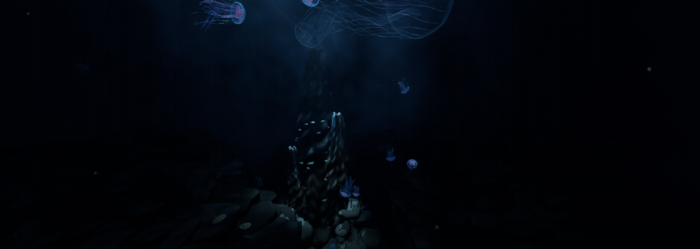
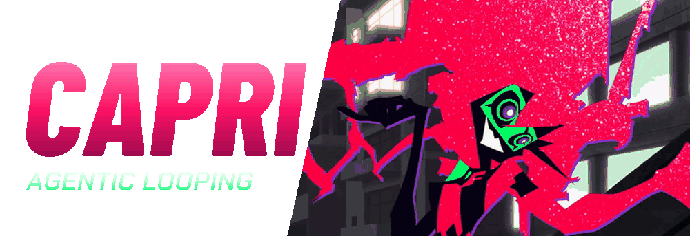
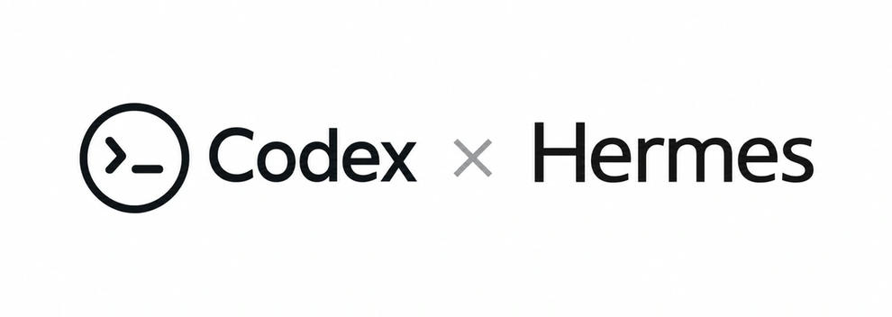
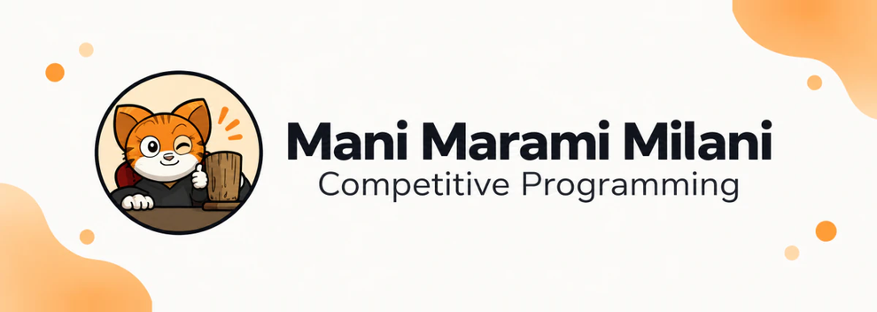
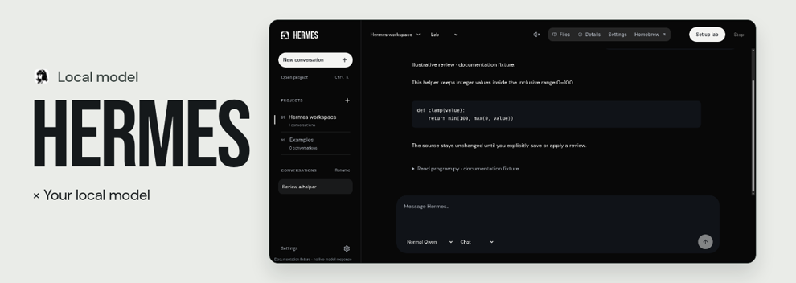

<a href="https://manimarami.com/"><picture><source media="(prefers-reduced-motion: reduce) and (prefers-color-scheme: dark)" srcset="./assets/tabs/portfolio-intro-waves-72a3c7a-20261026-dark-poster.webp"><source media="(prefers-reduced-motion: reduce)" srcset="./assets/tabs/portfolio-intro-waves-72a3c7a-20261026-light-poster.webp"><source media="(prefers-color-scheme: dark)" srcset="./assets/tabs/portfolio-intro-waves-72a3c7a-20261026-dark.gif"></picture></a>

<a href="https://github.com/Denoax/capri"><picture><source media="(prefers-reduced-motion: reduce)" srcset="./assets/tabs/capri-transparent-banner.png"></picture></a>

<a href="https://github.com/Denoax/visual-music"><picture><source media="(prefers-reduced-motion: reduce)" srcset="./assets/tabs/visual-music-loop-poster.webp?v=clean-title"></picture></a>

 

# MANI MARAMI MILANI
**Computer Science × Mathematics** 

[Portfolio](https://manimarami.com) · [GitHub projects](https://github.com/Denoax?tab=repositories) · [LinkedIn](https://www.linkedin.com/in/mani-marami-milani-8713a7309/) · [Pelagic live experience](https://denoax.github.io/pelagic-jellyfish-webgl/) · [Visual Music](https://denoax.github.io/visual-music/)

[Banner sources and editing notes](assets/tabs/PROJECT_BANNER_SOURCES.md).
